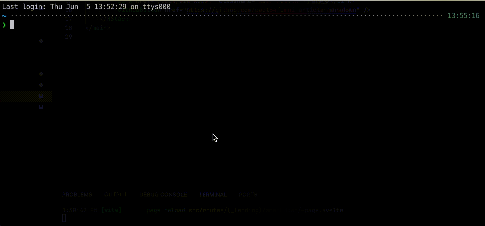
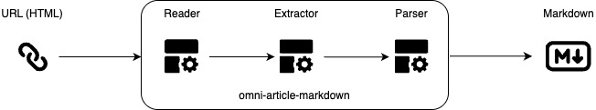

# 墨探 (omni-article-markdown)

[](https://pypi.org/project/omni-article-markdown/)

[](LICENSE)
[](https://pepy.tech/projects/omni-article-markdown)
[](https://hub.docker.com/r/caol64/omnimd)
[](https://github.com/caol64/omni-article-markdown)

轻松将网页文章（博客、新闻、文档等）转换为 `Markdown` 格式。



## 简介

[墨探](https://yuzhi.tech/amarkdown)的开发初衷，是为了解决一个问题：如何将来自互联网上各种不同网站的文章内容，精准且高效地转换成统一的Markdown格式。

众所周知，万维网上的网站设计风格迥异，其HTML结构也呈现出千差万别的特点。这种多样性给自动化内容提取和格式转换带来了巨大的困难。要实现一个能够适应各种复杂HTML结构的通用解决方案，并非易事。

我的想法是：从特定的网站开始适配，以点到面，逐步抽取出通用的解决方案，最后尽可能多的覆盖更多网站。

## 功能介绍

- **通用网页正文提取**：自动识别并提取文章主体，剔除导航、广告、推荐等无关内容
- **丰富的 HTML 元素转换**：标题、列表、表格、图片、代码块、引用等均可正确转换为对应 Markdown 语法
- **数学公式支持**：部分页面的 KaTeX / LaTeX 公式可转换为 Markdown 数学语法
- **动态渲染与反爬突破**：对需要 JS 渲染或有防爬策略的站点，内置浏览器方案获取完整页面
- **灵活的输出方式**：支持输出到 `stdout` 或直接保存为 Markdown 文件

已适配网站详见 [网站兼容列表](docs/sites.md)。

本项目同时提供 Agent Skill（[skills/omni-article-markdown/SKILL.md](skills/omni-article-markdown/SKILL.md)），可安装到 Claude Code、Codex 等 AI 客户端中使用。

## 安装与升级

```sh
# pipx
pipx install omni-article-markdown
pipx upgrade omni-article-markdown

# pip
pip install omni-article-markdown
pip install -U omni-article-markdown

# uv
uv tool install omni-article-markdown
uv tool install omni-article-markdown --upgrade
```

安装完成后即可使用：

```bash
mdcli -h
```

不想装 Python 环境，也可以用 Docker 镜像（详见 [README.docker.md](README.docker.md)）：

```bash
docker run --rm caol64/omnimd https://example.com/article
```

## 基本用法

**仅转换**

```sh
mdcli https://example.com
```

**保存到当前目录**

```sh
mdcli https://example.com -s
```

**保存到指定路径**

```sh
mdcli https://example.com -s /home/user/
```

**限制输出规模（适合 AI Agent 调用，防止长文撑爆上下文）**

```sh
# 截断到约 800 tokens（分段启发式估算，误差约 ±10%），段落边界收尾并追加 …[truncated] 标记
mdcli https://example.com --truncate
mdcli https://example.com --truncate 1500
```

**纯 Markdown 源原样输出**

源本身就是 Markdown（如 GitHub raw 链接）时，跳过 HTML 解析与转换，逐字节原样输出：

```sh
mdcli https://raw.githubusercontent.com/caol64/omni-article-markdown/refs/heads/main/README.md
```

## 架构说明



墨探主要分为三个模块：

- **Reader** 模块的功能是读取整个网页内容
- **Extractor** 模块的功能是提取正文内容，清理无用数据
- **Parser** 模块的功能是将 HTML 转换为 Markdown

## 贡献与反馈
- 发现解析问题？欢迎提交 [Issue](https://github.com/caol64/omni-article-markdown/issues)
- 改进解析？欢迎贡献 [Pull Request](https://github.com/caol64/omni-article-markdown/pulls)

## 赞助

如果你觉得墨探对你有帮助，可以给我家猫咪买点罐头 ❤️

[https://yuzhi.tech/sponsor](https://yuzhi.tech/sponsor)

## License

MIT License
